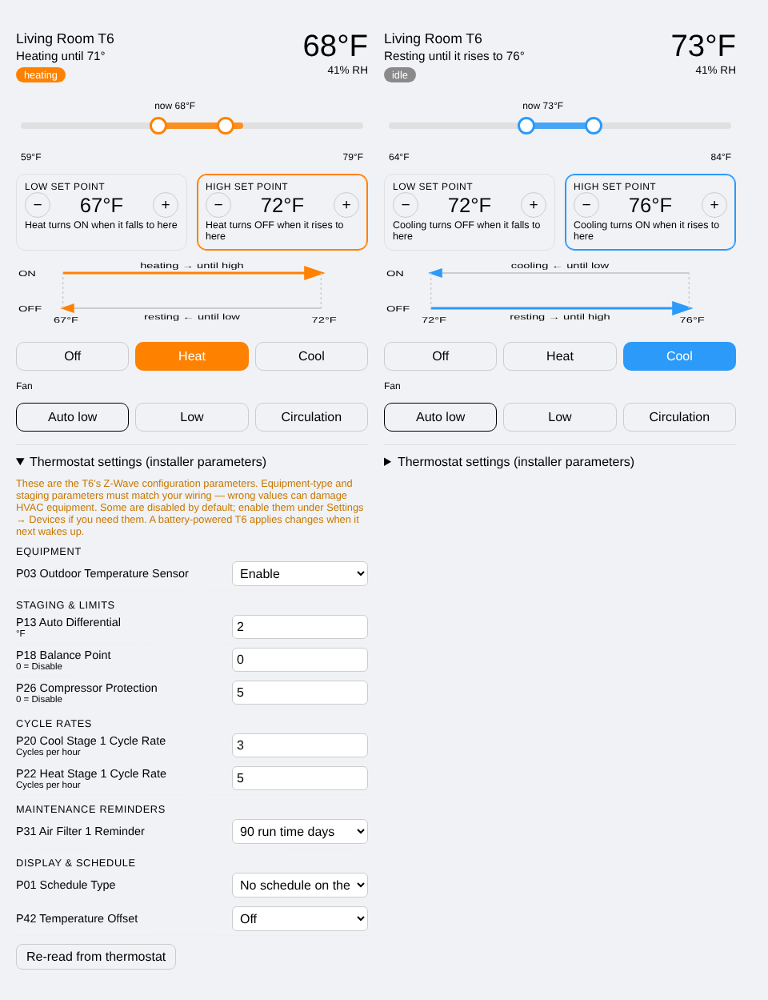

# Honeywell T6 Pro Z-Wave — Hysteresis control for Home Assistant

A custom integration and dashboard card for the **Honeywell T6 Pro Z-Wave (TH6320ZW)**, included in Home Assistant through **Z-Wave JS**.

* **Two set points with true hysteresis.**
  * **Heat:** the furnace runs until the room reaches the **high** set point. Then it stays off until the room falls to the **low** set point.
  * **Cool:** the AC runs until the room reaches the **low** set point. Then it stays off until the room rises to the **high** set point.
* **All 42 programmable (installer) parameters** of the T6 are exposed as `select` / `number` entities. Their values are read from and written to the thermostat over Z-Wave and update live.
* **Dashboard card** (`custom:t6-hysteresis-card`). It loads automatically and has a dual-handle band slider, ± buttons, a live hysteresis-loop diagram, mode and fan buttons, and an *Installer parameters* panel grouped by category.



## Install

1. Copy `custom_components/honeywell_t6` into your HA `config/custom_components/`. With HACS, add `https://github.com/keefeph/honeywell_t6` as a custom repository of type *Integration* instead (the repository must be public for HACS).
2. Restart Home Assistant.
3. Go to **Settings → Devices & services → Add integration → "Honeywell T6 Hysteresis"** and pick the T6's Z-Wave JS climate entity.
4. Add the card to a dashboard. You do not need to add a resource, because the integration registers it:

```yaml
type: custom:t6-hysteresis-card
entity: climate.living_room_t6_hysteresis   # the new climate entity
show_settings: true                          # installer-parameter panel (default true)
# range: [55, 85]                            # optional fixed slider range
```

The new entities are attached to the existing T6 device page:

| Entity | Purpose |
|---|---|
| `climate.<t6>_hysteresis` | The band thermostat (modes: off / heat / cool, `target_temp_low` / `target_temp_high`, fan pass-through) |
| `sensor.<t6>_hysteresis_phase` | `running` / `resting` / `off` / `override`. Use it for history and automations |
| `select.<t6>_pNN_…`, `number.<t6>_pNN_…` | The 42 configuration parameters |
| `button.<t6>_re_read_thermostat_settings` | Asks the T6 to report every parameter again |

The original Z-Wave JS climate entity is left untouched. Don't control it from other automations at the same time.

## How the hysteresis drives the T6

The T6 has no native "dead band" mode. It regulates to one set point using its own cycle-rate algorithm. The integration therefore runs the hysteresis state machine in Home Assistant and moves the T6 to get the behaviour:

| Mode | Phase | T6 is commanded to | Phase ends when |
|---|---|---|---|
| Heat | running | HEAT, set point = **high + drive offset** | room ≥ high → resting |
| Heat | resting | HEAT, set point = **low** *(or OFF in strict mode)* | room ≤ low → running |
| Cool | running | COOL, set point = **low − drive offset** | room ≤ low → resting |
| Cool | resting | COOL, set point = **high** *(or OFF in strict mode)* | room ≥ high → running |

The **drive offset** defaults to 1 °F / 0.5 °C. It stops the T6's cycle-rate logic from stopping just short of the band edge, so Home Assistant decides when the run ends.

### Options (Configure button on the integration)

| Option | Default | Notes |
|---|---|---|
| Resting strategy | **Move set point** | *Fail-safe.* If HA goes down, the T6 keeps regulating inside your band. *Strict* (`mode`) switches the T6 to **Off** while resting. That guarantees no calls, but the T6 stays off if HA stops. |
| Drive offset | 1 °F / 0.5 °C | 0 means use the band edge exactly |
| Minimum band width | 1 °F / 0.5 °C | The card and service enforce it |
| When switched on inside the band | Rest | *Rest* waits for the band edge (saves energy). *Run* drives to the far edge first (comfort). |
| Follow mode changes made on the thermostat | on | Wall change to Heat/Cool/Off is adopted. Auto / Em Heat suspends control (`override`) until you pick a mode in HA. |
| External temperature sensor | — | Uses a room sensor for the decisions instead of the T6's own reading |

### Services

* `honeywell_t6.set_band` (`low`, `high`). `climate.set_temperature` with `target_temp_low` / `target_temp_high` works too.
* `honeywell_t6.force_phase` (`running` / `resting`)
* `honeywell_t6.refresh_parameters`

### Things to know

* **Temperature resolution.** The T6 reports whole °F (0.5 °C), so band edges are reached at those steps.
* **The T6 still protects the equipment.** Compressor protection (P26), cycle rates (P20–P25) and min/max limits (P28/P29) remain active inside the thermostat.
* **Battery-only T6 (no C-wire).** The thermostat sleeps, so set-point and parameter writes are queued until it wakes. The hysteresis will be late by up to the wake interval. A C-wire is strongly recommended.
* **Z-Wave traffic.** At most one set-point/mode command per phase change, plus a reconcile every 2 min if the device drifted. Identical commands are not re-sent within 60 s.
* **State survives restarts.** Band, mode, phase and cycle count are restored after an HA restart.

## Configuration parameters

Generated from the Z-Wave JS device database. At runtime, the live metadata Z-Wave JS reports for your unit's firmware takes precedence. **Equipment parameters (P4–P11) start disabled** because a wrong value can damage a heat pump or furnace. Enable them deliberately under the device page.

| # | Parameter | Range / options | Default | Entity |
|---|---|---|---|---|
| 1 | Schedule Type | 0=No schedule on thermostat; 1=Single schedule; 2=5-2 schedule; 3=5-1-1 schedule; 4=Every day unique schedule | 5-2 schedule | select |
| 2 | Temperature Scale | 0=Fahrenheit; 1=Celsius | Fahrenheit | select |
| 3 | Outdoor Temperature Sensor | 0=Disable; 1=Enable | Disable | select |
| 4 | Equipment Type | 0=None; 1=Standard Gas; 2=High Efficiency Gas; 3=Oil; 4=Electric; 5=Fan Coil; 6=Air to Air Heat pump; 7=Geo… | High Efficiency Gas | select (disabled by default) |
| 5 | Reversing Valve | 0=O/B on Cool; 1=O/B on Heat | O/B on Cool | select (disabled by default) |
| 6 | Cool Stages | 0–2 | 1 | number (disabled by default) |
| 7 | Heat Stages | 0–2 | 1 | number (disabled by default) |
| 8 | Auxiliary/Emergency Control | 0=Both auxiliary and emergency; 1=Either auxiliary or emergency | Both auxiliary and emergency | select (disabled by default) |
| 9 | Auxiliary Heat Type | 0=Electric; 1=Gas/Oil | Electric | select (disabled by default) |
| 10 | Emergency Heat Type | 0=Electric; 1=Gas/Oil | Electric | select (disabled by default) |
| 11 | Fossil Kit Control | 0=Thermostat; 1=External | Thermostat | select (disabled by default) |
| 12 | Auto Changeover | 0=Disable; 1=Enable | Disable | select |
| 13 | Auto Differential | 0–5 °F | 0 | number |
| 14 | High Cool Stage Finish | 0=Disable; 1=Enable | Disable | select |
| 15 | High Heat Stage Finish | 0=Disable; 1=Enable | Disable | select |
| 16 | Auxiliary Heat Droop | 0=Comfort; 2=2 °F; 3=3 °F; 4=4 °F; 5=5 °F; 6=6 °F; 7=7 °F; 8=8 °F; 9=9 °F; 10=10 °F; 11=11 °F; 12=12 °F; 13… | Comfort | select |
| 17 | Up Stage Timer Aux Heat | 0=Off; 1=30 minutes; 2=45 minutes; 3=60 minutes; 4=75 minutes; 5=90 minutes; 6=2 hours; 7=3 hours; 8=4 hour… | Off | select |
| 18 | Balance Point | 0–65 °F (0=Disable) | Disable | number |
| 19 | Aux Heat Outdoor Lockout | 0–65 °F (0=Disable) | Disable | number |
| 20 | Cool Stage 1 Cycle Rate | 1–6 Cycles per hour | 3 | number |
| 21 | Cool Stage 2 Cycle Rate | 1–6 Cycles per hour | 3 | number |
| 22 | Heat Stage 1 Cycle Rate | 1–12 Cycles per hour | 3 | number |
| 23 | Heat Stage 2 Cycle Rate | 1–12 Cycles per hour | 3 | number |
| 24 | Aux Heat Cycle Rate | 1–12 Cycles per hour | 9 | number |
| 25 | Emergency Heat Cycle Rate | 1–12 Cycles per hour | 9 | number |
| 26 | Compressor Protection | 0–5 minutes (0=Disable) | 5 | number |
| 27 | Adaptive Intelligent Recovery | 0=Disable; 1=Enable | Disable | select |
| 28 | Minimum Cool Temperature | 50–99 °F | 50 | number |
| 29 | Maximum Heat Temperature | 40–90 °F | 90 | number |
| 30 | Air Filters | 0–2 | 0 | number |
| 31 | Air Filter 1 Reminder | 0=Disable; 1=10 run time days; 2=20 run time days; 3=30 run time days; 4=45 run time days; 5=60 run time da… | Disable | select |
| 32 | Air Filter 2 Reminder | 0=Disable; 1=10 run time days; 2=20 run time days; 3=30 run time days; 4=45 run time days; 5=60 run time da… | Disable | select |
| 33 | Humidification Pad Reminder | 0=Disable; 1=6 months; 2=12 months | Disable | select |
| 34 | Dehumidification Filter Reminder | 0–12 months (0=Disable) | Disable | number |
| 35 | Ventilation Filter Reminder | 0=Disable; 3=3 months; 6=6 months; 9=9 months; 12=12 months | Disable | select |
| 36 | UV Devices | 0–2 | 0 | number |
| 37 | UV Bulb 1 Reminder | 0=Disable; 6=6 months; 12=12 months; 24=24 months | Disable | select |
| 38 | UV Bulb 2 Reminder | 0=Disable; 6=6 months; 12=12 months; 24=24 months | Disable | select |
| 39 | Idle Brightness | 0–5 | 0 | number |
| 40 | Clock Format | 0=12 hour; 1=24 hour | 12 hour | select |
| 41 | Daylight Saving | 0=Disable; 1=Enable | Disable | select |
| 42 | Temperature Offset | 0=Off; -1=-1 °F / -0.5 °C; -2=-2 °F / -1.0 °C; -3=-3 °F / -1.5 °C; 1=+1 °F / +0.5 °C; 2=+2 °F / +1.0 °C; 3=… | Off | select |

## Development

```bash
pip install pytest-homeassistant-custom-component
pytest            # 9 state-machine tests + 12 end-to-end tests against a real HA core and a simulated T6
```
